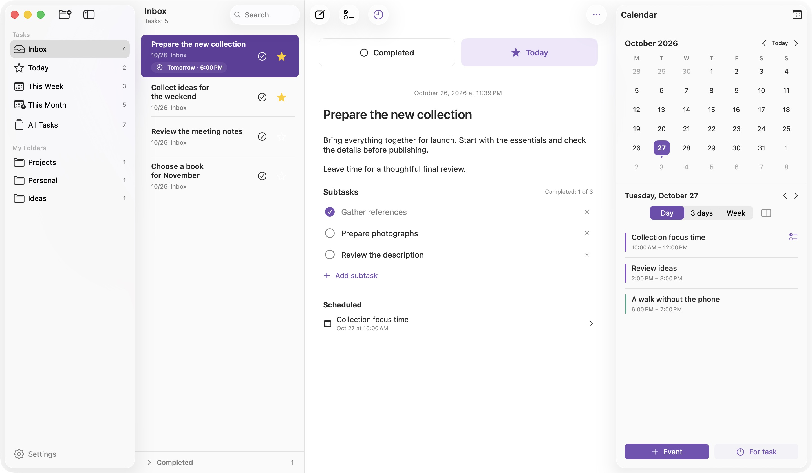

<p align="center">
  
</p>
<h1 align="center">Tasks for macOS</h1>
<p align="center">Your tasks, their next steps, and time to work on them.</p>
<p align="center"><a href="README.md">Русский</a> · <strong>English</strong></p>

Tasks brings folders, a focused daily list and your system calendar into one native Mac app. Your task library stays on your Mac. No account is required.



*An actual app screenshot using fictional demonstration data.*

## Features

- **Folders:** each task belongs to Inbox, This Week, Month or a custom folder. Today shows starred tasks; All Tasks shows the full library ordered by creation date.
- **Move tasks:** drag a task onto a sidebar folder, or use “Move to Folder” in its context menu or the toolbar “…” menu. Dropping onto Today adds a star and keeps the original folder.
- **Daily focus:** star tasks for today without changing their order.
- **Descriptions and subtasks:** plain text with list continuation, plus a checklist with completion progress.
- **Deadlines:** choose a date and optionally a time, independently of calendar events. System notifications follow deadline edits and are canceled when a task is completed or deleted.
- **Review reminder:** enable “Time to review your tasks” in Settings, choose a local time and optionally weekdays only. Off by default.
- **Calendar sidebar:** a compact month and a day, three-day or weekly agenda, with vertical and horizontal layouts.
- **Time for tasks:** create standalone events or schedule multiple time blocks for a task. Edit writable one-off events, drag them between days and undo a move.
- **Search:** find tasks by title and description within the current section.
- **Native macOS:** light and dark appearances, glass sidebars, keyboard shortcuts and Russian/English localization.

## Install

**macOS 26 or later.** The release is a universal binary for Apple Silicon and Intel.

Source version: **0.1.48 (build 49)**, a preview. [Changes in 0.1.48](docs/releases/v0.1.48.md) · [Changes from 0.1.32 to 0.1.42](docs/releases/v0.1.42.md) · [Release history](docs/releases).

Download the DMG from [**Releases**](https://github.com/Alex-De-Vep/tasks-macos/releases), open it, drag **Tasks** into **Applications**, then eject the disk image. Quit the app before replacing an earlier version.

**Signing:** this build uses an ad-hoc signature. It is not Developer ID signed or notarized by Apple. Gatekeeper may restrict opening a download on another Mac. You can build the app in Xcode if macOS does not allow the downloaded package to open. The project does not require disabling system security.

## Getting started

Press **⌘N** to create a task. Enter its title, then press **Return** to move to the description. Star it for today, add subtasks with the checklist button, or open the calendar using the rightmost toolbar button.

A new task belongs to the open folder. Today creates it in Inbox with a star; All Tasks creates it in Inbox. This Week and Month are permanent folders: date changes do not move tasks. The header counts only active search results. Moving a task preserves its contents, deadlines, notifications and calendar links.

Switching folders clears the open task and collapses completed tasks. Select a task to open it. Creating a task or following a calendar or notification link opens the requested task directly. Deleting the open task clears selection without automatically opening a neighbor.

Click the text or free space in a task row to open it. Star and completion buttons act independently. Titles, descriptions and subtasks remain editable, including in completed tasks.

Calendar access is optional. Once connected, the app uses calendars already configured in macOS. **Schedule time for task** creates an event linked to the selected task.

Configure notifications in **⌘, → Notifications**. Timed deadlines notify at their due time; date-only deadlines use the selected hour (09:00 by default). macOS permission is requested after assigning a deadline or explicitly enabling notifications. **Test notification** schedules a message in 5 seconds. macOS delivers scheduled messages even when the app is closed.

Calendar events support multiple relative or absolute alerts. Editing or removing one alert preserves the others. The system Calendar handles event notifications.

**Settings** contains three sections: **General** for language, **Notifications** for deadlines, reminder times, weekdays, testing and system permission, and **Calendar** for visible calendars and the default calendar for new events. [Settings and notification behavior](docs/settings.md#english).

| Shortcut | Action |
|---|---|
| ⌘N | New task |
| ⇧⌘N | New folder |
| ⌘Return | Toggle task completion |
| Delete | Delete the selected task when the list has focus |
| ⌘, | Settings |

## Privacy and current limitations

Tasks and preferences stay on your device. The app has no backend, ads or analytics SDKs. Calendar events live in the system event store and may sync through your configured calendar provider. See the [privacy description](docs/privacy.md).

- Task sync between devices is not implemented.
- Descriptions are plain text, without bold or italic formatting.
- Recurring events, recurrence exceptions and read-only calendars can be viewed but not edited.
- Deleting a task keeps its calendar events. Event scheduling and task completion are independent.
- All future deadlines are submitted. If macOS limits pending requests, the nearest deadlines and repeating reminders take priority; the queue refills when the app launches, becomes active or tasks change. macOS permission and Focus settings control banner presentation.
- This is an evolving app. Keep a system backup before relying on it for important information.

## Build

Requires macOS 26+, Xcode 26 with Swift 6.2 support, Command Line Tools and Python 3 for helper scripts. The localization package is included; the app has no external network dependencies.

Open `Planner.xcodeproj`, select **Planner → My Mac**, and run with **⌘R**.

Compile the app and test sources without running tests:

```sh
xcodebuild -project Planner.xcodeproj -scheme Planner \
  -configuration Debug -destination 'generic/platform=macOS' \
  -derivedDataPath .build/DerivedData build-for-testing
```

Build a universal release and DMG:

```sh
python3 scripts/build_release.py
```

Artifacts are written to `dist/`. [Development guide](docs/development.md) · [Release guide](docs/releasing.md).

## Contributing

Bug reports and suggestions are welcome in [**Issues**](https://github.com/Alex-De-Vep/tasks-macos/issues). Please read [CONTRIBUTING.md](CONTRIBUTING.md). Do not attach personal task libraries, calendar information, tokens or signing keys.

Compiling tests does not mean they have passed. Check the release notes for the validation performed.

## License

Licensed under the [Apache License 2.0](LICENSE). See [NOTICE](NOTICE) for attribution.

Created by [Alex-De-Vep](https://github.com/Alex-De-Vep).
