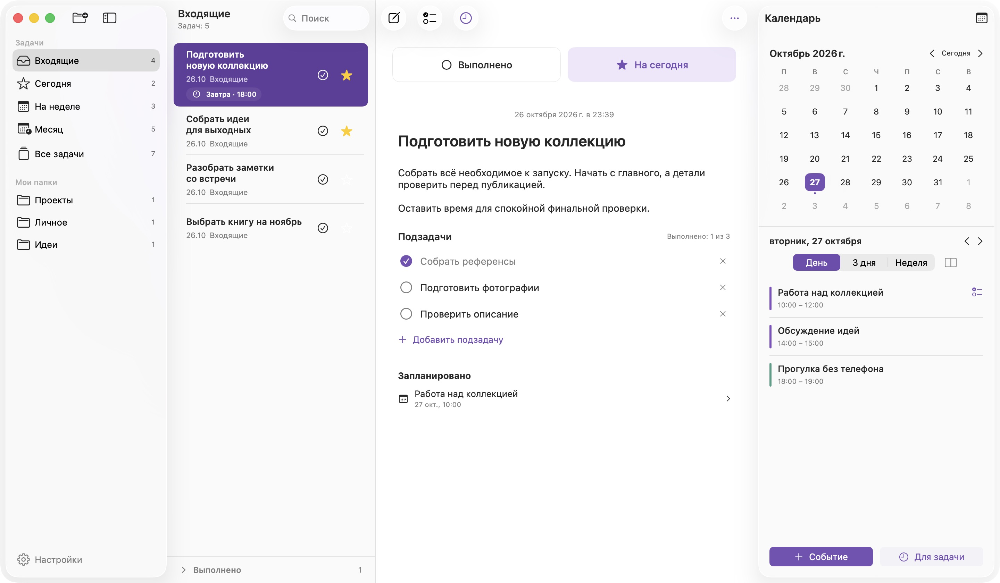

<p align="center">
  
</p>

<h1 align="center">Задачи для macOS</h1>
<p align="center">Задачи, подзадачи и время для них — в одном нативном приложении.</p>
<p align="center"><strong>Русский</strong> · <a href="README.en.md">English</a></p>

«Задачи» помогает собрать дела по папкам, выбрать главное на сегодня и выделить время в системном календаре. Привычный интерфейс macOS, локальное сохранение и никаких обязательных аккаунтов.

<picture>
  <source media="(prefers-color-scheme: dark)" srcset="docs/screenshots/workspace-dark-ru.png">
  
</picture>

*Настоящие снимки приложения с вымышленными демонстрационными данными.*

## Что умеет приложение

- **Папки.** Каждая задача находится во «Входящих», «На неделе», «Месяц» или своей папке. «Сегодня» собирает отмеченные звёздочкой задачи, «Все задачи» показывает общую библиотеку по дате создания.
- **Перенос задач.** Перетащите задачу на папку слева или выберите «Переместить в папку» в контекстном меню либо меню «…» в шапке. Перетаскивание на «Сегодня» добавляет звезду и сохраняет основную папку.
- **Фокус на день.** Жёлтая звезда отмечает задачу на сегодня. Изменение звезды и названия сохраняет порядок списка.
- **Описание и подзадачи.** Отдельные название и описание, текстовые списки, контрольный список с прогрессом выполнения.
- **Сроки.** Дата и необязательное время, независимо от звезды и календарных событий. Системные уведомления переносятся вместе со сроком и отменяются при выполнении или удалении задачи.
- **Напоминание о планах.** В настройках можно включить «Пора проверить задачи», выбрать время и режим «Только по будням». По умолчанию оно выключено.
- **Календарь рядом.** Компактный месяц и расписание на день, три дня или неделю; вертикальный список или горизонтальные колонки.
- **События и планирование.** Создание самостоятельных событий, редактирование разовых событий, перенос между днями и отмена переноса. Для задачи можно выделить несколько отрезков времени.
- **Поиск.** По названию и описанию внутри выбранного раздела.
- **Нативное поведение.** Светлая и тёмная темы, стеклянные боковые панели, клавиатурные команды, русский и английский интерфейс.

## Установка

**Требуется macOS 26 или новее.** Релизная сборка универсальная: Apple Silicon и Intel.

Версия исходного кода — **0.1.46 (сборка 47)**, предварительный выпуск. [Изменения 0.1.46](docs/releases/v0.1.46.md) · [Изменения 0.1.32 → 0.1.42](docs/releases/v0.1.42.md) · [История изменений](docs/releases).

1. Скачайте DMG из раздела [**Releases**](https://github.com/Alex-De-Vep/tasks-macos/releases).
2. Откройте образ и перетащите **Задачи** в **Applications / Программы**.
3. Извлеките образ и откройте приложение из «Программ».

**Подпись:** текущая сборка подписана локально (ad-hoc), без Developer ID и нотариализации Apple. На другом Mac Gatekeeper может ограничить открытие загруженного приложения. Если macOS не позволяет открыть пакет, можно собрать приложение самостоятельно в Xcode. Проект не требует отключать системную защиту.

При обновлении сначала завершите приложение. Не удаляйте его sandbox-контейнер: там хранится библиотека задач.

## Как начать

Создайте задачу кнопкой в шапке или **⌘N**. Назовите её и нажмите **Enter**, чтобы перейти к описанию. Звезда добавляет задачу в «Сегодня», а кнопка контрольного списка — подзадачу. Панель календаря открывается крайней правой кнопкой.

Новая задача принадлежит открытой папке. В «Сегодня» она создаётся во «Входящих» со звездой, во «Всех задачах» — во «Входящих». «На неделе» и «Месяц» — постоянные папки: смена даты не перемещает задачи. Счётчик в шапке показывает только активные результаты поиска. Перенос сохраняет содержимое, сроки, уведомления и связи с календарём.

При переходе в другую папку открытая задача сбрасывается, а выполненные сворачиваются. Выберите задачу из списка, чтобы открыть её. Создание задачи и переход из календаря или уведомления сразу открывают нужную карточку. Удаление открытой задачи очищает выбор: соседняя задача сама не открывается.

Задача открывается нажатием на текст или свободную область строки. Звезда и выполнение работают отдельно. Название, описание и подзадачи остаются доступными для редактирования, в том числе у выполненных задач.

Подключение календаря необязательно. Если разрешить доступ, приложение показывает календари, уже настроенные в macOS. Действие **«Выделить время для задачи»** создаёт событие и связывает его с открытой задачей.

Настройте уведомления через **⌘, → Уведомления**. Для срока с временем уведомление приходит в этот момент; для срока без времени используется выбранный в настройках час, по умолчанию 09:00. Разрешение macOS запрашивается при первом назначении срока или явном включении уведомлений. Кнопка **«Проверить уведомление»** отправляет тест через 5 секунд. Уже запланированные уведомления доставляет система, в том числе при закрытом приложении.

У календарного события можно добавить несколько напоминаний, в том числе на конкретную дату. Удаление одной строки сохраняет остальные. Уведомления о событиях доставляет системный календарь.

В **Настройках** доступны три раздела: **Основные** — язык интерфейса; **Уведомления** — сроки, время напоминаний, будни, проверка и системные разрешения; **Календарь** — отображаемые календари и календарь для новых событий. [Все настройки и поведение уведомлений](docs/settings.md).

| Команда | Действие |
|---|---|
| ⌘N | Новая задача |
| ⇧⌘N | Новая папка |
| ⌘Enter | Переключить выполнение задачи |
| Delete | Удалить выбранную задачу, когда фокус в списке |
| ⌘, | Настройки |

## Данные и ограничения

Задачи и настройки хранятся локально. В приложении нет собственного сервера, рекламы или аналитических SDK. События хранятся в системном календаре и могут синхронизироваться через настроенного пользователем провайдера. [Подробнее о конфиденциальности](docs/privacy.md).

- Синхронизация **задач** между устройствами пока не реализована.
- Описание — обычный текст, без форматирования жирным или курсивом.
- Повторяющиеся события, их исключения и календари только для чтения доступны для просмотра.
- Удаление задачи сохраняет её календарные события. Выполнение задачи и события независимы.
- Приложение планирует все будущие сроки. Если macOS ограничивает очередь, приоритет получают ближайшие сроки и повторяющиеся напоминания; очередь пополняется при открытии приложения, возвращении в него и изменениях задач. Показ баннеров зависит от разрешения macOS и режима «Фокусирование».
- Приложение развивается. Перед использованием с важными данными сохраняйте резервную копию системы.

## Сборка из исходников

Нужны macOS 26+, Xcode 26 с поддержкой Swift 6.2 и Command Line Tools. Для вспомогательных скриптов нужен Python 3. Внешних сетевых зависимостей у приложения нет; пакет переводов находится в репозитории.

Откройте `Planner.xcodeproj`, выберите схему **Planner** и **My Mac**, затем нажмите **⌘R**.

Сборка приложения и тестовых исходников **без запуска тестов**:

```sh
xcodebuild -project Planner.xcodeproj -scheme Planner \
  -configuration Debug -destination 'generic/platform=macOS' \
  -derivedDataPath .build/DerivedData build-for-testing
```

Универсальная Release-сборка и DMG:

```sh
python3 scripts/build_release.py
```

Результаты находятся в `dist/`: приложение, образ DMG и контрольная сумма SHA-256. [Устройство проекта и разработка](docs/development.md) · [Подготовка релиза](docs/releasing.md).

## Участие в проекте

Сообщения об ошибках и предложения приветствуются в [**Issues**](https://github.com/Alex-De-Vep/tasks-macos/issues). Перед отправкой изменений прочитайте [CONTRIBUTING.md](CONTRIBUTING.md). Не прикладывайте личные задачи, календарные события, токены и ключи подписи.

Успешная сборка тестовых исходников не означает прохождение тестов: текущий статус проверок указан в описании выпуска.

## Лицензия

Проект распространяется по [Apache License 2.0](LICENSE). Уведомления об авторстве находятся в [NOTICE](NOTICE).

Автор: [Alex-De-Vep](https://github.com/Alex-De-Vep).
