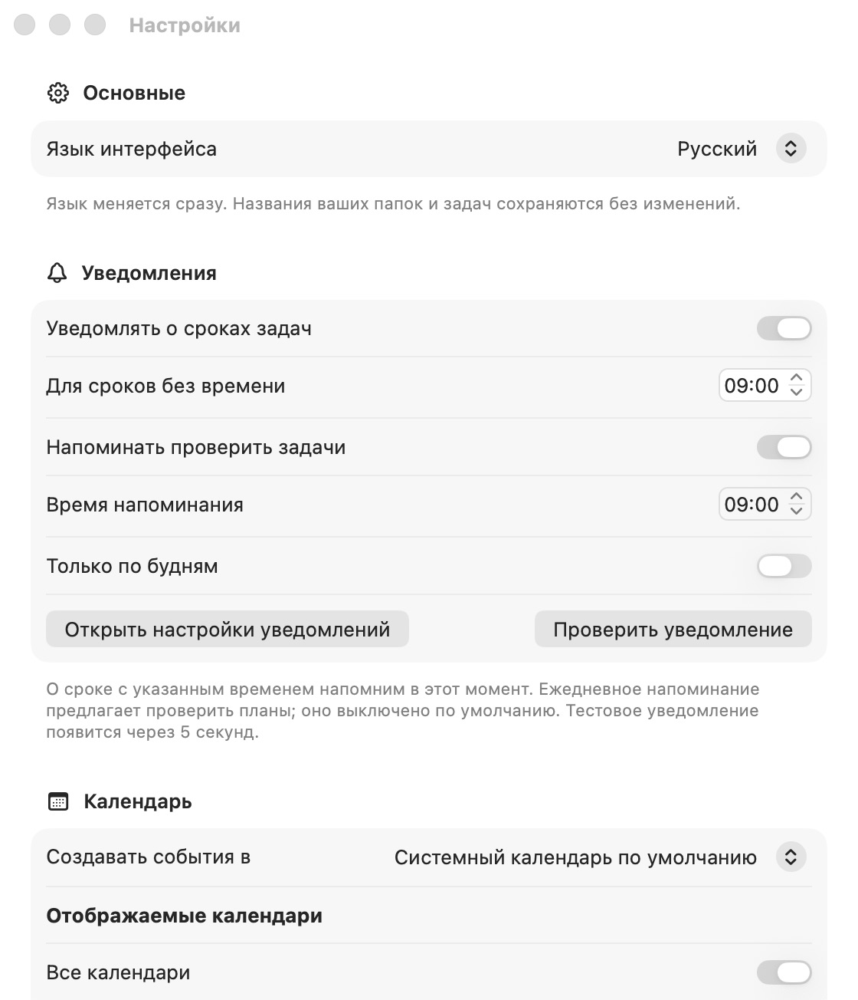

# Настройки и уведомления

Откройте настройки через **⌘,** или кнопку внизу панели папок.

*На снимке демонстрационная сборка. Ежедневное напоминание включено, чтобы показать параметры; по умолчанию оно выключено.*

## Основные

Язык интерфейса: **Русский**, **English** или **Как в системе**. Изменение применяется сразу; пользовательские названия и описания не переводятся. По умолчанию выбран русский язык.

## Уведомления

| Настройка | Поведение | По умолчанию |
|---|---|---|
| Уведомлять о сроках задач | Локальное уведомление для будущего срока незавершённой задачи | Включено; требуется разрешение macOS |
| Для сроков без времени | Местный час уведомления в выбранный день | 09:00 |
| Напоминать проверить задачи | Отдельное напоминание «Пора проверить задачи» | Выключено |
| Время напоминания | Местное время ежедневного напоминания | 09:00 |
| Только по будням | Ежедневное напоминание с понедельника по пятницу | Выключено |
| Разрешить уведомления | Запрос разрешения macOS, если решение ещё не принято | Показывается при необходимости |
| Открыть настройки уведомлений | Переход к системным настройкам уведомлений | Доступно всегда |
| Проверить уведомление | Локальное тестовое сообщение через 5 секунд | По нажатию |

Для срока с указанным временем используется сам момент срока. Для срока без времени сохраняются календарный день и выбранный местный час. Ежедневное напоминание также следует за местным временем при смене часового пояса.

Редактирование срока переносит уведомление; переименование обновляет текст. Выполнение, удаление задачи или снятие срока отменяет ожидающее уведомление и убирает относящееся к задаче доставленное сообщение. Возврат задачи в работу восстанавливает напоминание, если срок ещё впереди. Прошедшие сроки не создают уведомления задним числом.

Нажатие на уведомление о сроке открывает соответствующую задачу, при необходимости её папку. Общее напоминание открывает рабочее окно. Уже запланированные запросы доставляет macOS, даже когда приложение закрыто. Для показа нужны системное разрешение и подходящие настройки баннеров, звука и «Фокусирования».

Планировщик отправляет в macOS все будущие сроки и повторяющиеся напоминания. Если системный центр не сохраняет часть запросов из-за ограничения очереди, приоритет получают ближайшие сроки и повторения, а в настройках появляется пояснение. Очередь обновляется при запуске, возвращении в приложение, изменениях задач, языка, времени и разрешений. При закрытом приложении отложенные сверх очереди сроки не добавляются сами.

Ошибки планирования остаются видны в настройках вместе с действием **Повторить**. Отказ в разрешении не блокирует задачи; его можно изменить в macOS. Напоминания **событий** настраиваются в форме события и доставляются системным календарём отдельно от уведомлений приложения.

## Календарь

- Подключение системных календарей и переход к настройкам доступа.
- Выбор календаря для создания событий из доступных для записи. Можно оставить системный календарь по умолчанию.
- Показ всех календарей либо выбор отдельных. Режим «Все календари» включает и календари, добавленные в macOS позднее.

Эти параметры доступны после предоставления полного доступа к календарям. Отказ не мешает работе с локальными задачами.

## English

Open Settings with **⌘,** or the button at the bottom of the folder sidebar.

**General:** Russian, English or system language; changes apply immediately without translating your content. Russian is the initial default.

**Notifications:** deadline reminders are enabled by default, subject to macOS permission. Timed deadlines notify at their due instant; date-only deadlines use a configurable local time, initially 09:00. The separate review reminder is off by default; enable it daily or Monday–Friday and choose its local time. Settings also provide permission controls, a test notification after 5 seconds, error details and Retry.

Editing a deadline reschedules the request; renaming updates its message. Completing or deleting a task or removing its deadline cancels the request and clears its delivered message. Reopening a task restores a future reminder. Clicking a deadline notification opens that task; a review reminder opens the workspace. macOS handles scheduled delivery while the app is closed, subject to permission, Focus and notification presentation settings.

The scheduler submits all future deadlines and repeats. If macOS limits pending requests, the earliest deadlines and repeats take priority; Settings indicates when others are deferred. The queue refills on launch, activation and relevant changes. Deferred requests beyond the queue are not automatically added while the app is closed. Event alerts are handled separately by the system calendar.

**Calendar:** connect system calendars, select writable calendars for new events, and choose which calendars to display. “All calendars” also includes calendars added later in macOS. Declining access does not prevent local task management.
